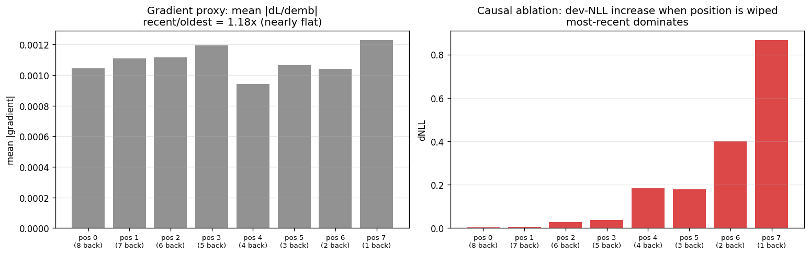
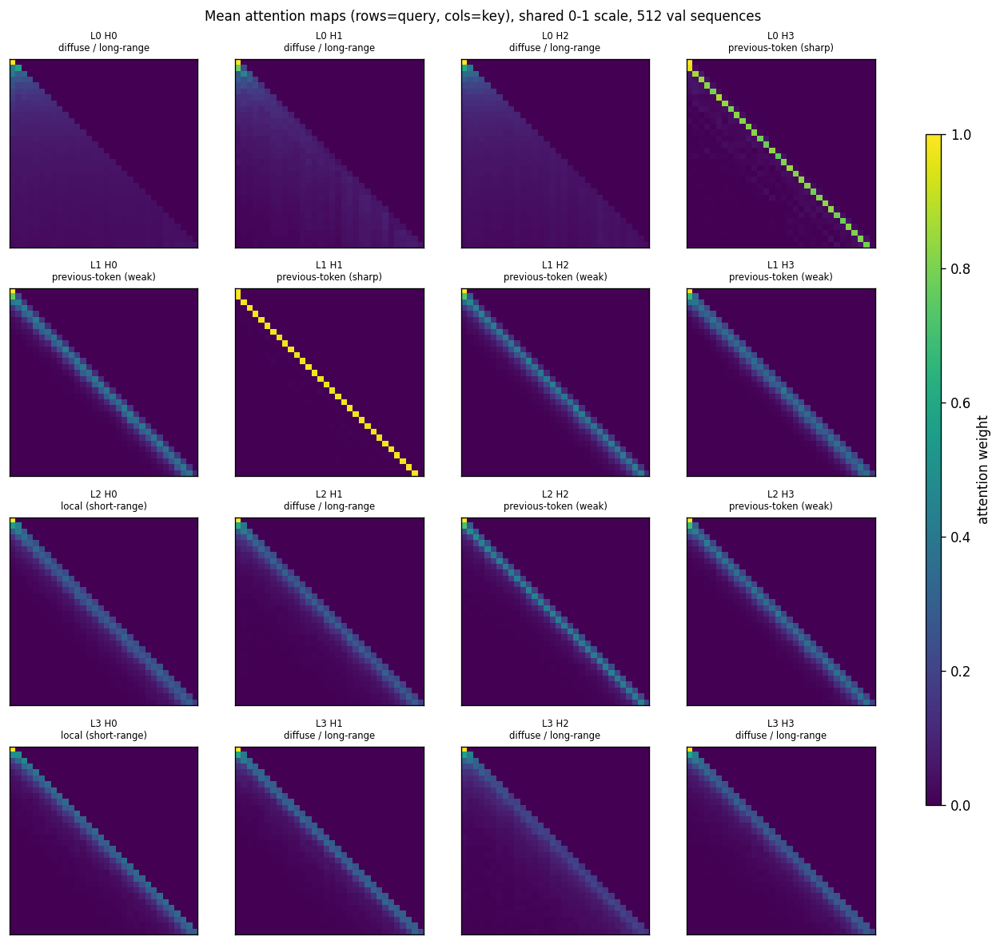
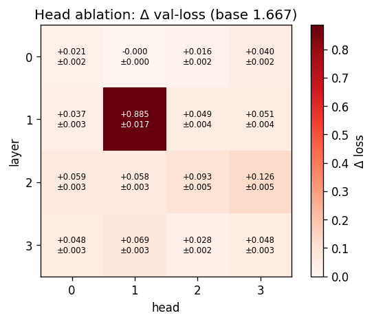
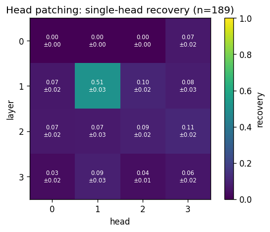

I trained a small character-level GPT with sixteen attention heads. One of them carries most of its next-character prediction. A second head has nearly the same attention pattern and can be removed at almost no cost. Inspecting the two heads does not show which one the model needs. Intervening on the model does.

This is the second of two posts on a series of four repos. The [first](/posts/micrograd/) covered the autograd engine. This one covers the two language-model repos: [makemore](https://github.com/diego-magana/makemore), which builds character-level models from a bigram up to a WaveNet, and [gpt](https://github.com/diego-magana/gpt), the transformer. Both follow Karpathy's lectures and his [makemore](https://github.com/karpathy/makemore) and [nanoGPT](https://github.com/karpathy/nanoGPT) code. In both I added tooling to answer one question about the trained model: which parts of it does the prediction depend on?

Here are the two heads side by side. Heads are named by layer and index, counting from zero, so L1 H1 is the second head in the second layer.

|  | L1 H1 | L0 H3 |
|---|---:|---:|
| Attention on the previous character | 0.98 | 0.82 |
| Rise in validation loss when removed (nats) | 0.89 | 0.04 |
| Prediction recovered when restored alone | 0.51 | 0.07 |
| Positions where the weights point one step back | 94% | 100% |

The first row is each head's attention pattern and the last is what its weights compute. The middle two rows are interventions, and only they show which head the model needs. The rest of this post explains each row.

## A measurement that gave the wrong answer

The question came out of makemore. That repo trains five models on 32K first names, ending with a hierarchical WaveNet that has 76,579 parameters and predicts the next character from the previous 8. I wanted to know how much each of those 8 positions matters to the prediction.

The first measure was the size of the gradient of the loss with respect to each position's embedding. It came back nearly flat. The most recent position scored 1.18 times the oldest, which suggests the model uses all 8 characters about equally.

The second measure was an intervention. I replaced one position's embedding with the average embedding at that position, so the model could not tell which character had been there, and measured the rise in held-out loss. Removing the most recent character cost 0.87 nats. Removing the oldest cost 0.003.


_Left: gradient size at each context position. Right: rise in held-out loss when that position is removed. Position 7 is the most recent character._

The gradient measure was misleading. It reports how sensitive the loss is to a small change at a position, which is a different quantity from how much the prediction depends on what is there. For the transformer I measured dependence by intervening.

## The model

gpt is a decoder-only transformer trained on Tiny Shakespeare, one character per token. It has 4 layers with 4 attention heads each, 64-dimensional embeddings, a 32-character context and 209,729 parameters. After 30,000 training steps its validation loss is 1.65 nats. A bigram baseline, which predicts from the current character alone, scores 2.47.

The architecture is Karpathy's. My change is to the forward pass, which can record, remove or replace the output of any head:

```python
# remove a head: zero the output of layer 1, head 1
logits, loss = model(xb, yb, ablate_heads={(1, 1)})

# record every intermediate value from a run
logits, _, cache = model(x_clean, return_cache=True)

# rerun a different input with one head's output replaced by the recorded one
logits, _ = model(x_corrupt, patch_heads={(1, 1): cache.head_out[1][:, 1]})
```

When none of these arguments are set, the forward pass is the ordinary one.

## Two heads that look the same

I averaged each head's attention over 512 held-out sequences. Two heads put most of their attention on the character just before the current one. L1 H1 puts 0.98 there and L0 H3 puts 0.82. No other head is above 0.44. On the attention maps the two look like the same kind of head.


_Mean attention for all 16 heads. L0 H3 (top right) and L1 H1 (second row, second column) each show a single bright line one step below the diagonal._

## Removing a head

The direct test of whether the model needs a head is to set its output to zero and measure validation loss again.

Removing L1 H1 raises the loss by 0.89 ± 0.02 nats, seven times the effect of any other head. The loss goes from 1.67 to 2.55, slightly worse than the bigram baseline. Removing L0 H3 raises it by 0.04. The error bars are the standard error of the per-batch difference between the ablated and intact model on the same batches.


_Rise in validation loss when each head is removed, with standard errors._

The two heads look alike and differ by a factor of about 20 in how much the model needs them.

The reason L0 H3 is cheap to remove is redundancy. With L1 H1 already removed, removing L0 H3 costs 0.23 instead of 0.04. It is a backup whose contribution is hidden while the stronger head is present.

## Restoring a head

Ablation removes a component. Patching restores one, which is a more specific test. The procedure:

1. Run the model on a clean 32-character context and record every intermediate value.
2. Replace the character one position before the end with a random one and run again. Keep the example if the top prediction changed, which happened in 189 of 256 cases.
3. Run the corrupted input again with one recorded clean value put back, and measure how much of the gap between the clean and corrupted predictions closes. A recovery of 0 means none of it and 1 means all of it.

First I restored the residual stream, the running vector that each block reads and adds to, at one position at a time. This shows where the information about the changed character is held. After block 0 it is still at the character's own position. Restoring that position recovers 0.97, and restoring the last position recovers 0.07. After block 1 those numbers are 0.24 and 0.74. Block 1 moves the information to the position that makes the prediction.

Block 1 has four heads, and restoring one head's output at a time separates them. L1 H1 alone recovers 0.51 ± 0.03 of the prediction. The next best head recovers 0.11, and L0 H3 recovers 0.07.


_Share of the prediction recovered when a single head's clean output is restored in a corrupted run._

The recovery is below 1.0 because the changed character also reaches the prediction through other heads, and those stay corrupted in this test.

## What the weights say

The results above measure behavior on data. Two properties can also be read from the weights alone, with no forward pass.

### Where the head looks

Using only the position embeddings and the head's query and key weights, L1 H1 attends exactly one position back at 94% of positions. L0 H3 does so at 100%, and no other head exceeds 52%. The two heads compute the same positional pattern, which fits L0 H3 being a backup.

### What the head writes

L1 H1 does not copy the attended character straight to the output. Attending to a character raises that character's own logit the most for only 2% of characters. Its output does keep the 65 characters distinct. So the head moves the identity of the previous character to the current position, and turning that into a prediction is left to layers 2 and 3.

## Other seeds

I retrained the same architecture from four other seeds for 3,000 steps each and repeated the ablation. In all five models the most important head is a previous-token head in layer 0 or 1. The head itself varies. It is L1 H1 in this model and L0 H0, L0 H1 or L0 H3 in the others. All five runs built the same mechanism. They did not put it in the same place.

## Limits

- This is one mechanism in a 210K-parameter model with a 32-character context. The model is too small for longer-range behavior such as induction heads, and it leans mostly on the nearest characters. Changing the previous character flips the prediction 73% of the time, and changing the one five positions back flips it 19% of the time. The result is not evidence about how larger models work.
- Removing a head sets its output to zero, which also gives later layers an input they never saw in training. Patching does not have that problem, and it points to the same head.
- The patching numbers describe the 189 examples where changing the previous character changed the prediction, not all predictions.
- I did not run path patching. Which later components read what L1 H1 writes is inferred from the weights and has not been measured.
- The seed comparison uses 3,000-step models. The main analysis uses the 30,000-step one.

## Engineering notes

Four practices from this project carry over to other work:

- The measuring tools are tested. Two unit tests check that restoring a run's own recorded values changes nothing, once for the residual stream and once for a single head. If either failed, none of the recovery numbers could be trusted.
- Evaluation has its own random generator. In Karpathy's code, training and evaluation draw from one generator, so the trained weights depend on how often you evaluate. Separating them removes that dependence.
- A checkpoint stores the model's configuration with its weights, and loading rebuilds the architecture from it. Weights cannot be loaded into a slightly different model by accident.
- CI runs the tests and executes the analysis notebook against the committed checkpoint, so the analysis keeps running as the code changes.

## The rest of the series

The fourth repo, [tokenizer](https://github.com/diego-magana/tokenizer), is a byte-level BPE tokenizer with one experiment on vocabulary size. Its README is the complete write-up, so it has no post of its own. In short, on held-out prose a 16k vocabulary packs 4.20 bytes into each token and GPT-2's 50k vocabulary packs 4.66. Each doubling of the vocabulary saves fewer tokens than the one before.

That completes the series: an autograd engine, a set of character-level models, a transformer with the tooling to test what it depends on, and a tokenizer. The full results for this post, including a logit lens and a sweep over corruption distance, are in the [gpt README](https://github.com/diego-magana/gpt) and in [`05_attention_analysis.ipynb`](https://github.com/diego-magana/gpt/blob/main/notebooks/05_attention_analysis.ipynb). The makemore analysis is in [`06_probing.ipynb`](https://github.com/diego-magana/makemore/blob/main/notebooks/06_probing.ipynb).
