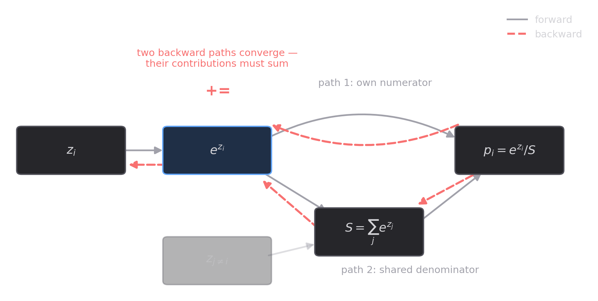
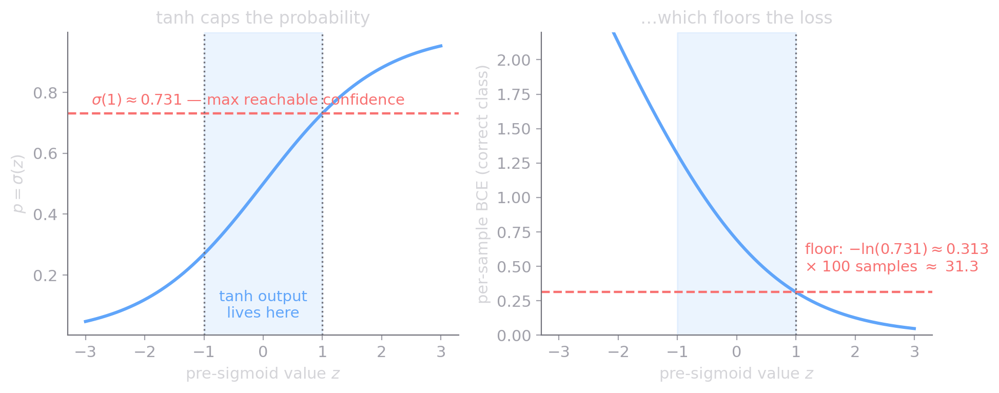

micrograd is a scalar autograd engine. A `Value` holds one number and records every operation applied to it, and `backward()` walks that record to compute a gradient for every number involved. It is the same algorithm as PyTorch's `loss.backward()`, applied to single numbers instead of tensors, which makes it slow and easy to read.

I rebuilt it from Karpathy's [micrograd](https://github.com/karpathy/micrograd) lecture and added a small neural network library, tests that check every gradient against PyTorch, and a classification demo. The code is at [github.com/diego-magana/micrograd](https://github.com/diego-magana/micrograd).

I built it to understand what `loss.backward()` does instead of trusting it. Karpathy argues that [backprop is a leaky abstraction](https://karpathy.medium.com/yes-you-should-understand-backprop-e2f06eab496b). If you only trust the framework, its failure modes still reach you, later and with less information to debug them.

This post covers three things: the gradient rules, the bugs that give wrong gradients without failing, and a loss plateau that I first took for a bug. It is the first of two posts on a series of four repos. The [second](/posts/gpt/) covers the language models that came next.

## Eight backward rules

Every operation registers a backward rule on its output. The engine has eight. Three are operators:

$$
\frac{\partial}{\partial a}(a+b) = 1 \qquad
\frac{\partial}{\partial a}(ab) = b \qquad
\frac{\partial}{\partial a}(a^n) = na^{n-1}
$$

Five are functions: `tanh`, `exp`, `log`, `relu` and `sigmoid`. A rule is a closure created when the operation runs. Multiplication looks like this:

```python
def __mul__(self, other):
    other = other if isinstance(other, Value) else Value(other)
    out = Value(self.data * other.data, (self, other), '*')

    def _backward():
        self.grad += other.data * out.grad    # d(ab)/da = b
        other.grad += self.data * out.grad    # d(ab)/db = a
    out._backward = _backward
    return out
```

Each line of `_backward` is the chain rule. It multiplies the local derivative by the gradient that arrived at the output.

The forward pass builds the graph as a side effect of ordinary arithmetic. The backward pass runs the closures in reverse topological order. Subtraction, division and negation are built from the three operators, so they need no rules of their own.

The hardest test in the suite is softmax with negative log-likelihood. I built it from `exp`, division and `log` on `Value` objects, with no dedicated layer, and the engine returned the textbook gradient without being told what softmax is:

$$
\frac{\partial L}{\partial z_i} = p_i - \mathbb{1}[i = y]
$$

The test checks this against the closed form to 1e-15 and against PyTorch to nine significant figures.

It is a hard test because each $e^{z_i}$ is used twice, once in its own numerator and once in the shared denominator. Its gradient arrives along two paths, and the two contributions have to be added.


_Each exponentiated logit feeds its own numerator and the shared denominator, so two backward paths meet at that node and their contributions are added._

## Wrong gradients do not raise errors

The difficult part of an autograd engine is that its worst bugs are silent. A wrong gradient does not raise an exception, and the loss often still goes down. There are three places in this engine where that can happen.

The first is accumulation. A backward rule has to add to `.grad` with `+=`, not assign with `=`. In `y = x * x` the node `x` is used twice, and $dy/dx = 2x$ only because both contributions are summed. With `=`, the second write replaces the first, and at $x = 3$ the gradient comes out as 3 instead of 6.

The second is ordering. `backward()` has to visit nodes in reverse topological order. A node hands its gradient to its inputs, so it must first receive the full gradient from everything that uses it. Without the sort, some nodes pass on a partial gradient.

The third hides in ordinary Python. The softmax denominator is `sum(counts)`, and `sum()` starts from the integer `0`. The first addition is `0 + Value`, which fails in `int.__add__` and falls back to `Value.__radd__`. Without `__radd__` the engine works for every expression I write by hand and breaks the first time a standard library function touches it. The reflected operators are what make the type behave like a number.

Because none of these fail loudly, the tests are the argument that the engine is correct. Each rule is checked against PyTorch's autograd, with the PyTorch tensors cast to float64 so that float32 precision does not limit the comparison. The simple cases assert agreement to 1e-5. The two cases that reuse nodes heavily, a long mixed expression and the softmax, assert agreement to nine significant figures.

One test checks the claim that these bugs are silent. `test_accumulation_is_not_assignment` replaces `+=` with `=` in the addition rule, trains a small MLP on 30 points, and asserts that the loss still falls. It does. The loss starts at 46.3, and the correct engine brings it to 7.2. The broken engine also brings it down, but to a different value on each run. Three runs with the same seed ended at 8.77, 9.55 and 11.42.

The run-to-run difference has a specific cause. `backward()` builds its ordering by iterating over a `set` of nodes, and the order of a set of objects depends on their memory addresses. With `+=` this has no effect, because every path contributes and addition is commutative. With `=` the last write wins, and which write comes last changes from run to run.

## A loss floor set by the architecture

My first demo trained `MLP(2, [16, 16, 1])`, 337 parameters, on 100 points from the two-moons dataset. Training was 100 epochs of full-batch gradient descent at a learning rate of 0.01, with binary cross-entropy on a sigmoid of the output.

Accuracy reached 100 of 100. The summed loss stopped at 31.84 and would not go lower. I assumed a bug in the engine.

The cause was arithmetic. In that version the output layer ended in tanh like every other layer, so the value going into the sigmoid was confined to $(-1, 1)$ and the predicted probability was capped:

$$
p = \sigma(z) < \sigma(1) \approx 0.731
$$

The best possible loss per sample is then $-\ln(0.731) \approx 0.313$, which over 100 samples is 31.33. The network sat at 31.84, 1.6% above a floor set by its own architecture. It classified every point correctly and could not be confident about any of them.


_Left: the tanh output keeps the sigmoid's input between -1 and 1, which caps the probability at 0.731. Right: that cap puts a floor of 0.313 under the per-sample loss._

[`scripts/loss_floor.py`](https://github.com/diego-magana/micrograd/blob/main/scripts/loss_floor.py) rebuilds that network so the result can be checked. A fresh run ends at 32.20 against the same floor of 31.33.

The same saturation also slowed learning. A mean loss of 0.318 per sample puts the average tanh output near 0.98, where its local gradient $1 - \tanh^2$ is about 0.04. The output unit was passing back about 4% of the gradient it received.

The floor could have been computed before training, from the architecture alone. When a loss stops falling, the first thing I check now is the lowest loss the model can reach.

The fix is a linear output layer that produces unbounded logits and leaves the squashing to the loss function, which is what every framework does. `MLP` in the repo now always builds its last layer that way.

## The demo in the repo

The current demo applies that fix to a harder problem. It uses three interleaved spirals, 99 points in total, split into 69 for training and 30 for testing. I generate the data directly. The model is `MLP(2, [16, 16, 3])` with softmax and negative log-likelihood, and a linear model with no hidden layer is the baseline.

| Model | Parameters | Test accuracy |
|---|---:|---:|
| Linear softmax, `MLP(2, [3])` | 9 | 0.27 |
| `MLP(2, [16, 16, 3])` | 371 | 0.87 (train 0.99) |

The baseline is there to show that the problem needs hidden layers. Its test loss is 1.14, and guessing uniformly gives $\ln 3 \approx 1.10$. It is not undertrained, because its training loss is the same at step 80 and at step 3,000. A linear model cannot draw a curved boundary, so it leans toward one class. It predicts class counts of 14, 8 and 8 where the true counts are 7, 11 and 12.

## Limits

- The engine is scalar. One `Value` per number and a Python loop per forward pass is slow. It handles 99 two-dimensional points and would not handle a real dataset. That is the price of being able to read every step.
- The test set has 30 points, so accuracy moves in steps of one thirtieth. The gap between train and test accuracy comes from a small dataset with overlapping classes near the origin.
- The softmax is the plain form. With large logits it would need the log-sum-exp trick to stay numerically stable.

## Next

The second post, [gpt: sixteen attention heads, one doing most of the work](/posts/gpt/), moves from whether the gradients are correct to what a trained network depends on.
